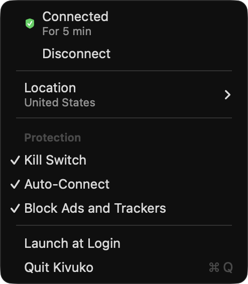

<h1 align="center">Kivuko</h1>

<p align="center">
  <strong>A tiny NordVPN client for the Mac menu bar.</strong><br>
  WireGuard (NordLynx), a kill switch enforced by macOS, and ad-blocking DNS, in about 30 MB of memory.
</p>

<p align="center">
  
</p>

<p align="center"><sub><em>Kivuko</em> is Swahili for a crossing, or the ferry that carries you over.</sub></p>

---

## What it does

- **One click.** Connect and Disconnect sit at the top of the menu. Quit turns the VPN off too.
- **Any country.** Location lists every country NordVPN serves, with your recent picks first. Fastest Server takes Nord's recommendation for where you are.
- **Kill switch.** While the VPN is on or reconnecting, macOS blocks anything that would leave outside it. Your local network still works.
- **Auto-Connect.** Reconnects on any network, after sleep, and when Kivuko starts, until you click Disconnect.
- **Block ads and trackers.** Uses Nord's Threat Protection Lite DNS. Turn it off for Nord's plain DNS.
- **Self-healing.** If a server doesn't answer within 8 seconds, Kivuko tries the next one. If a connection goes quiet, it renews the handshake, and if that fails, macOS restarts the tunnel on a fresh server.

## How light

Measured on a MacBook Pro running macOS 26:

| | Memory | CPU |
|---|---|---|
| Menu-bar app | 26 MB | 0% when idle |
| Tunnel | 4 MB | Under 1% with background traffic; about a quarter of one core at 200+ Mbit/s |

The measured download speed through a NordVPN server was 212 Mbit/s.

## How it works

```text
Kivuko.app                     Rust (objc2): the menu-bar app
└── PlugIns/KivukoTunnel.appex Rust: NEPacketTunnelProvider + GotaTun (WireGuard)
```

- **The menu-bar app** keeps the VPN configuration that macOS stores, including the kill switch, On-Demand and DNS.
- **The tunnel is a NetworkExtension packet-tunnel provider.** macOS starts it on its own, so the VPN doesn't need the app running.
- **It picks a server from Nord's recommendations.** It then hands macOS the addresses, routes and DNS, and runs [GotaTun](https://github.com/mullvad/gotatun), Mullvad's audited Rust WireGuard, on the tunnel interface macOS creates.
- **Nothing leaks.** IPv6 goes into the tunnel too, so it can't leak around it.


## Your credentials

- **Your NordVPN access token** stays in your login keychain. You paste it into Kivuko once.
- **On Connect, the app hands the token to the tunnel.** The tunnel fetches your WireGuard key from Nord: its own traffic is allowed past the kill switch, and the app's isn't.
- **The tunnel stores the key in its sandbox container**, readable only by you (mode 0600). macOS's shared VPN settings are readable by every user, so nothing secret is stored there.
- **The logs record events only**, never the token or the key.

## Setup

Kivuko is a personal build, signed for development with the owner's Apple developer account.

```bash
scripts/bundle.sh --install   # build, sign for this Mac, install to /Applications and open
cargo test                    # unit tests
cargo test -p nord -- --ignored   # live checks against Nord's API
```

## Layout

| Path | What it does |
|---|---|
| `app/` | Menu, Connect and Disconnect, Location, toggles, token prompt, VPN configuration |
| `provider/` | The tunnel: server choice, network settings, GotaTun on the utun, watchdog |
| `nord/` | NordVPN API client: recommendations, countries, the NordLynx key |
| `shared/` | IDs, settings and the app↔tunnel messages |
| `signing/` | A stub Xcode project used only to get development signing |
| `scripts/bundle.sh` | Build, sign, install |

## License

[PolyForm Noncommercial 1.0.0](LICENSE.md). © 2026 piedol. WireGuard is a registered trademark of Jason A. Donenfeld. NordVPN and NordLynx are trademarks of Nord Security; Kivuko is not affiliated with them.
