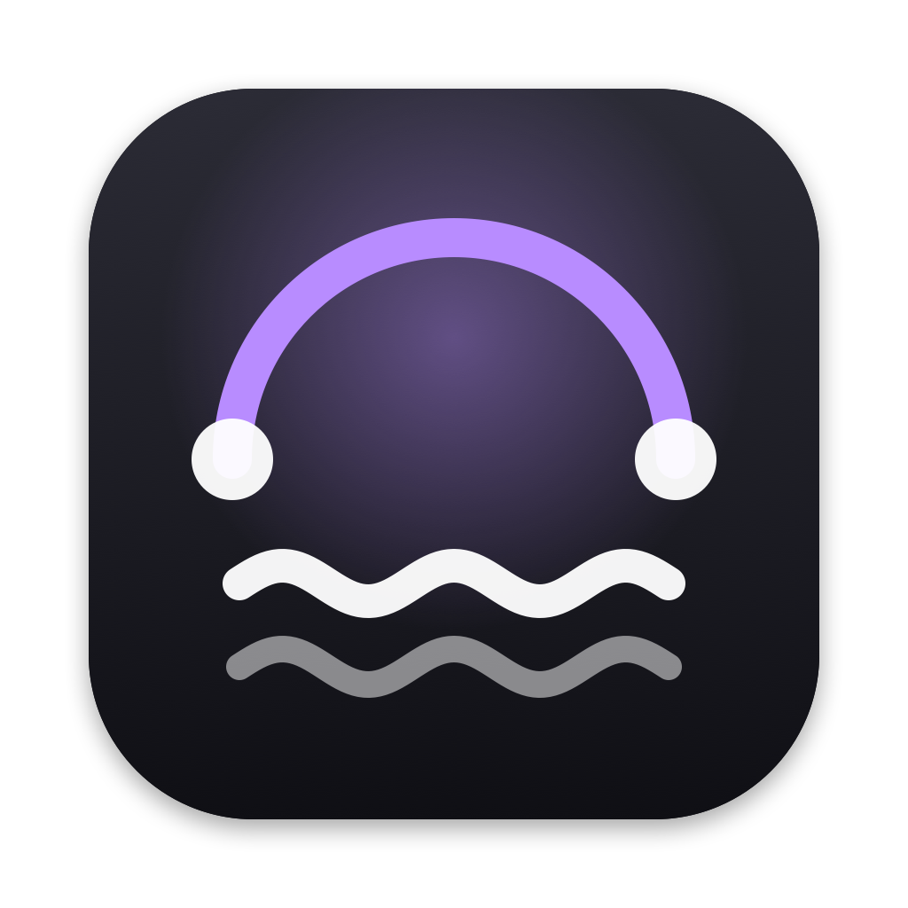
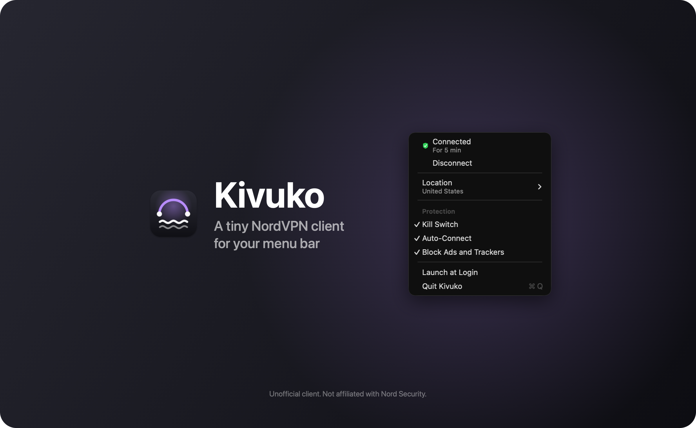

<p align="center">
  
</p>

<h1 align="center">Kivuko</h1>

<p align="center">
  A NordVPN client for the Mac menu bar, written in Rust and built on WireGuard.
</p>

<p align="center">
  
  <a href="LICENSE"></a>
</p>

<p align="center">
  
</p>

Kivuko connects your Mac to NordVPN over WireGuard (NordLynx) from the menu bar. Its kill switch is enforced by macOS. Kivuko reconnects after sleep and network changes, and it can block ads and trackers through NordVPN's DNS. The menu bar app uses about 23 MB of memory and the tunnel about 8 MB.

Its tunnel runs [GotaTun](https://github.com/mullvad/gotatun), Mullvad's Rust implementation of WireGuard, inside a macOS system extension. macOS starts and restarts the tunnel, for example after sleep.

<p align="center"><sub><em>Kivuko</em> (kee-VOO-koh) is Swahili for "crossing" or "ferry".</sub></p>

> [!NOTE]
> Kivuko is an independent project. It is not made, endorsed or supported by Nord Security. You need your own NordVPN subscription.

## Contents

- [Features](#features)
- [Requirements](#requirements)
- [Install](#install) · [Uninstall](#uninstall)
- [Build from source](#build-from-source)
- [How it works](#how-it-works)
- [Privacy and security](#privacy-and-security)
- [Resource use](#resource-use)
- [Development](#development)
- [Credits](#credits) · [License](#license)

## Features

- Connect and Disconnect are at the top of the menu. Quitting Kivuko turns the VPN off.
- **Location** lists every country NordVPN serves, with your recent choices first. **Fastest Server** uses NordVPN's recommendation for where you are.
- With **Kill Switch** on, macOS blocks any traffic that would leave outside the tunnel while the VPN is on or reconnecting. Your local network keeps working.
- **Auto-Connect** reconnects on any network, after sleep and when Kivuko starts, until you click Disconnect.
- **Block Ads and Trackers** uses NordVPN's Threat Protection Lite DNS. With it off, Kivuko uses NordVPN's standard DNS.
- If a server doesn't answer within 8 seconds, Kivuko tries the next server, up to three. If no WireGuard handshake arrives for 3 minutes, it forces a new handshake, and after 6 minutes macOS restarts the tunnel on a new server (with Auto-Connect on).
- IPv6 traffic goes into the tunnel, where NordVPN drops it, so it can't leak around the VPN.
- In the release build, **Check for Updates…** looks for a new version, and with **Check for Updates Automatically** on, Kivuko looks once a day. When a new version is out, a notification says so and the menu shows **Update to Kivuko X.Y.Z…** with the release notes. **Install and Relaunch** turns the VPN off, replaces the app and opens the new version, which connects again if Auto-Connect is on.

## Requirements

- A Mac with Apple silicon and macOS 14 or later (so far tested only on macOS 26)
- A NordVPN subscription

## Install

1. Download `Kivuko-macOS-arm64.zip` from the [Releases page](https://github.com/piedol/kivuko/releases). It's signed and notarized by Apple.
2. Unzip it, drag **Kivuko** into your Applications folder and open it from there. macOS installs Kivuko's tunnel only for an app in Applications.
3. Click the shield in the menu bar and choose **Allow Kivuko's VPN in System Settings…**. Turn Kivuko on under General › Login Items & Extensions › Network Extensions, and enter your password when macOS asks.
4. Get a NordVPN access token from [Nord Account](https://my.nordaccount.com/) › NordVPN › Advanced settings › Access token.
5. Choose **Set Up and Connect** in the menu. Paste the token, click **Save and Connect**, then click **Allow** when macOS asks to add a VPN configuration.

Later versions install from the menu: **Check for Updates…**, or the daily check.

### Uninstall

Follow [Uninstalling](docs/setup.md#uninstalling) in order. Deleting the app first can leave the kill switch blocking your connection until you remove the VPN configuration.

## Build from source

You need a paid [Apple Developer Program](https://developer.apple.com/programs/) membership: macOS loads VPN extensions only when they're signed through a paid account. The full guide is [docs/setup.md](docs/setup.md).

1. Clone the repository and choose a bundle ID prefix of your own, such as `com.yourname`:

   ```bash
   git clone https://github.com/piedol/kivuko.git
   ```

   ```bash
   cd kivuko && cp signing/local.env.example signing/local.env
   ```

   Set `KIVUKO_BUNDLE_PREFIX` in `signing/local.env`, and `KIVUKO_TEAM` if your Apple ID is in several developer teams. `scripts/bundle.sh --check` shows what will be signed.

2. Build, sign and install the development build. On the first run, Xcode registers your Mac and the two bundle IDs and downloads development profiles:

   ```bash
   scripts/bundle.sh --install
   ```

Development profiles last a year. When they expire, macOS stops loading the development build, and running `scripts/bundle.sh --install` again renews them. Don't install a second copy of Kivuko: with two copies of the tunnel registered, opening either app makes macOS stop the other's tunnel, which drops the VPN.

`scripts/bundle.sh` builds Kivuko in two ways. Both need Xcode signed in with a paid Apple Developer Program account, XcodeGen and Rust 1.95 or later. On the first run of each, Xcode creates the provisioning profiles by building the stub project in `signing/`.

| | Development build | Release build |
|---|---|---|
| Command | `scripts/bundle.sh`, or `scripts/bundle.sh --install` to install it | `scripts/bundle.sh --release` |
| Tunnel | App extension, `Contents/PlugIns/KivukoTunnel.appex` | System extension, `Contents/Library/SystemExtensions/<prefix>.kivuko.tunnel.systemextension` |
| Signing | Apple Development certificate and development profiles, valid for the Macs registered in your account | Developer ID Application certificate and Developer ID profiles |
| Notarization | None | Notarized and stapled |
| Output | `dist/Kivuko.app` | `dist/Kivuko-macOS-arm64.zip` |
| Runs from | Any folder | /Applications. On the first launch, macOS asks you to allow the tunnel in System Settings › General › Login Items & Extensions |
| Updates | Build and install it again | **Check for Updates…** in the menu, and a daily check |

The release build also needs a notarytool keychain profile. Create it with `xcrun notarytool store-credentials`, and set its name in `KIVUKO_NOTARY_PROFILE` (the default is `piedol-notary`).

`cargo build` builds the development variant. The `sysext` feature of the `app` and `provider` crates builds the release variant:

```bash
cargo build --release -F app/sysext -F provider/sysext
```

## How it works

```text
Kivuko.app                                           app/       menu bar app: menu, token prompt, VPN configuration
└── Contents/Library/SystemExtensions/
    └── top.piedol.kivuko.tunnel.systemextension     provider/  packet tunnel: server choice, GotaTun, watchdog
```

The development build carries the same tunnel as an app extension, `Contents/PlugIns/KivukoTunnel.appex`.

- The menu bar app manages the VPN configuration that macOS keeps in System Settings › VPN, including the kill switch, the On-Demand rule and the DNS choice.
- The tunnel is a NetworkExtension packet-tunnel provider. macOS starts it whenever the VPN starts, including automatic reconnects while the app isn't running.
- On each start, the tunnel asks NordVPN for recommended WireGuard servers, gives macOS the addresses, routes and DNS, and runs GotaTun on the tunnel interface macOS creates.

[docs/architecture.md](docs/architecture.md) explains the design decisions, the connection sequence and the watchdog.

## Privacy and security

- Your NordVPN access token is stored in your login keychain. When you click Connect, the app hands it to the tunnel, which uses it to fetch your WireGuard key from NordVPN.
- The tunnel keeps the WireGuard key in its own sandbox container, readable only by your user (mode 0600).
- Any user on the Mac can read macOS's VPN configuration, so Kivuko stores only your country and DNS choice there.
- The logs record events, never the token or the key.
- Kivuko talks to NordVPN's API and the VPN server you're connected to, and sends no analytics. The release build also checks GitHub once a day for a new version. Turn off **Check for Updates Automatically** in the menu to stop it.
- An update installs only if the download matches the checksum GitHub lists for it and the app inside is signed by Kivuko's developer, carries Kivuko's bundle ID and is notarized by Apple.

[docs/setup.md](docs/setup.md#what-kivuko-stores) lists every file Kivuko writes.

## Resource use

Measured on a MacBook Pro with macOS 26:

| | Memory | CPU |
|---|---|---|
| Menu bar app | 23 MB | 0% when idle |
| Tunnel | 8 MB | Under 1% with background traffic; about 26% of a core while downloading at 212 Mbit/s |

## Development

| Path | What it does |
|---|---|
| `app/` | The menu, Connect and Disconnect, Location, toggles, the token prompt, the VPN configuration and the release build's updates |
| `provider/` | The tunnel: server choice, network settings, GotaTun on the utun interface, the watchdog |
| `nord/` | The NordVPN API client: server recommendations, countries and the NordLynx key |
| `shared/` | Bundle IDs, settings and the messages between the app and the tunnel |
| `signing/` | A stub Xcode project that gets the development and Developer ID provisioning profiles |
| `scripts/bundle.sh` | Build and sign, then install the development build or notarize the release build |

### Contributing

Bug reports and pull requests are welcome. Before opening a pull request, run:

```bash
cargo fmt --check
cargo clippy --workspace --all-targets -- -D warnings
cargo test
```

`cargo test -p nord -- --ignored` runs live checks against NordVPN's API.

## Credits

- [GotaTun](https://github.com/mullvad/gotatun) by Mullvad, the WireGuard implementation the tunnel runs.
- [wireguard-apple](https://github.com/WireGuard/wireguard-apple), whose method for finding the tunnel's utun interface Kivuko follows.
- [objc2](https://github.com/madsmtm/objc2), which Kivuko uses to call Apple's frameworks from Rust.

## License

Copyright 2026 piedol.

Kivuko is free software under the [GNU General Public License v3.0 or later](LICENSE). You can use, study, share and change it, including at work. If you distribute a modified version, you must release its source under the same license.

WireGuard is a registered trademark of Jason A. Donenfeld. NordVPN and NordLynx are trademarks of Nord Security, which is not affiliated with this project.
